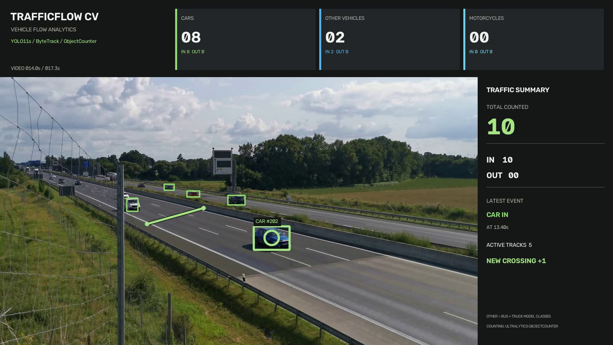

# TrafficFlow CV – Fahrzeugerkennung und Verkehrszählung

Ein Python-basiertes Computer-Vision-Projekt zur automatischen Erkennung, Verfolgung und Zählung von Fahrzeugen in Verkehrsvideos.



## Projektübersicht

TrafficFlow CV analysiert Verkehrsvideos mithilfe von YOLO11s und ByteTrack. Fahrzeuge werden mit Bounding Boxes und Tracking-IDs visualisiert.

Beim Überqueren einer benutzerdefinierten virtuellen Linie werden die Fahrzeuge automatisch gezählt. Die Ergebnisse erscheinen in einem übersichtlichen Dashboard.

## Funktionen

- Fahrzeugerkennung mit YOLO11s
- Multi-Object-Tracking mit ByteTrack
- Interaktive Auswahl einer Zähllinie
- Automatische IN/OUT-Verkehrszählung
- Visualisierung der Tracking-IDs
- Dashboard mit Fahrzeugstatistiken
- Export eines analysierten MP4-Videos
- CSV-Export der registrierten Zählereignisse

## Technologien

- Python
- OpenCV
- Ultralytics YOLO11s
- ByteTrack
- NumPy

## Installation

Repository klonen:

```bash
git clone https://github.com/abbasovdul-ux/TrafficFlow-CV.git
cd TrafficFlow-CV
```

Benötigte Bibliotheken installieren:

```bash
pip install -r requirements.txt
```

## Verwendung

1. Ein eigenes Verkehrsvideo unter `videos/traffic_test.mp4` speichern.
2. Das Programm starten:

```bash
python traffic_counter_fixed.py
```

3. Im ersten Videoframe zwei Punkte für die Zähllinie auswählen.
4. Mit `S` die Analyse starten.

Die Ergebnisse werden im Ordner `results` gespeichert.

## Demo-Ergebnis

Im getesteten kurzen Verkehrsvideo wurden 12 Linienüberquerungen registriert.

Die Darstellung unterscheidet zwischen Autos, Motorrädern und weiteren Fahrzeugen. Intern verwendet das Modell die COCO-Klassen `car`, `motorcycle`, `bus` und `truck`.

## Einschränkungen

Die Ergebnisse hängen von Kameraperspektive, Sichtverhältnissen und Tracking-Stabilität ab.

Insbesondere können Transporter, Busse und LKW aus größerer Entfernung verwechselt werden. Die Fahrzeugklassifizierung ist daher als Modellschätzung zu verstehen.

Dieses Projekt ist ein Portfolio-Prototyp und kein für den produktiven Verkehrseinsatz validiertes Messsystem.
